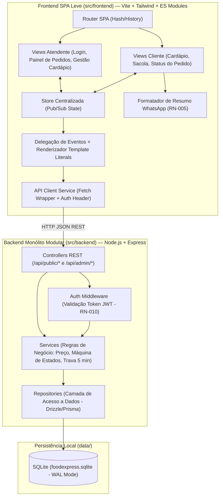

# Diretrizes de Arquitetura e Tecnologia — FoodExpress

> **Status:** Concluído no `/passo2` (Aguardando Aprovação Formal do Usuário)
> **Versão:** 1.0.0
> **Última Atualização:** 2026-11-11
> **Metodologia:** Vibe Coding Sensato & Spec Driven Development (SDD)

---

## 1. Princípios Arquiteturais

1. **Spec-First (SDD):** Nenhuma implementação de código ocorre sem especificação prévia aprovada em [`docs/brd.md`](./brd.md) e [`docs/trd.md`](./trd.md).
2. **Simplicidade e Modularidade (Monólito Modular em Camadas):** Separação estrita entre responsabilidades de interface (`src/frontend`), regras de negócio e API (`src/backend`) e suíte de verificação automatizada (`tests/`), permitindo que a equipe de 3 pessoas trabalhe em paralelo nas Sprints 1 e 2 sem conflitos de código.
3. **Execução Local Zero-Config (Sem Dependências Externas Complexas):** Banco de dados relacional em arquivo único local (**SQLite** gerenciado via **Drizzle ORM** / **Prisma**), sem necessidade de provisionar servidores de banco externos ou containers pesados para rodar o projeto.
4. **Renderização Leve e Reativa no Cliente:** Arquitetura **Single-Page Application (SPA) Leve** utilizando **Vite + Vanilla JS Modular (ES Modules) + Tailwind CSS**, estruturada com **Store Centralizada (Padrão Pub/Sub)**, renderização declarativa via **Template Literals** e **Delegação de Eventos** centralizada no DOM.
5. **Segurança e Confiabilidade desde o Design:** Senhas de atendentes armazenadas com hash criptográfico irreversível (`node:crypto scrypt`), autenticação administrativa via token assinado (`JWT` / HMAC-SHA256) e cobertura automatizada integral das regras de negócio críticas (`RNF-003`).

---

## 2. Stack Tecnológica Definida (Com Análise de Trade-offs)

| Camada | Tecnologia / Framework | Versão Alvo | Justificativa Técnica & Trade-offs |
| :--- | :--- | :--- | :--- |
| **Frontend / UI** | **Vite + Vanilla JS Modular (ES Modules) + Tailwind CSS** | Vite 5.x / ES2023 / Tailwind 3.x | **Prós:** Bundle mínimo, altíssima velocidade no celular (`RNF-001`), controle total do DOM via Template Literals e Delegação de Eventos sem overhead de Virtual DOM.<br>**Contras:** Exige disciplina de sanitização HTML (`escapeHtml`) e organização explícita da Store Pub/Sub. |
| **Backend / API** | **Node.js + Express** | Node 20+ / Express 4.x | **Prós:** Leve, amplamente conhecido, inicialização instantânea, excelente suporte a middlewares REST (autenticação, validação de payloads e tratamento centralizado de erros).<br>**Contras:** Single-threaded (plenamente suficiente para a carga operacional de lanchonetes e restaurantes de pequeno/médio porte). |
| **Banco de Dados & ORM** | **SQLite (Arquivo Local) + Drizzle ORM** *(ou Prisma ORM)* | SQLite 3 (`better-sqlite3`) + Drizzle ORM | **Prós:** Banco relacional ACID real em arquivo único (`data/foodexpress.sqlite`), tipagem forte de schema, migrations/seed instantâneos e zero dependência de infraestrutura externa.<br>**Contras:** Escrita concorrente massiva é limitada pelo lock de arquivo do SQLite (mitigado com `PRAGMA journal_mode = WAL;`). |
| **Autenticação & Segurança** | **JWT (HMAC-SHA256) + Hash `scrypt` (`node:crypto`)** | Nativo Node.js | **Prós:** Usa o módulo criptográfico nativo do Node.js sem pacotes nativos quebradiços, garantindo senhas irreversíveis (`RNF-002`) e proteção stateless nas rotas `/api/admin/*` (`RN-010`). |
| **Testes Automatizados** | **Vitest + Supertest** | Vitest 2.x / Supertest 7.x | **Prós:** Compatível nativamente com Vite e ES Modules, execução em milissegundos para validar todas as regras financeiras, limites de 140 caracteres, máquina de estados e janela de 5 minutos (`RNF-003`). |
| **Infra / CI-CD** | **GitHub Actions + Deploy Automatizado** | Node 20 Alpine | **Prós:** Atende diretamente às tarefas técnicas `T01` (CI em cada push/PR) e `T02` (CD automático após testes verdes). |

---

## 3. Visão de Componentes e Fluxo de Dados

### 3.1. Diagrama de Arquitetura em Camadas



### 3.2. Estratégia de Manipulação do DOM e Renderização Visual
Para garantir alta performance em celulares (`RNF-001`) sem dependências complexas de frameworks reativos pesados:
1. **Estado Único (Store Pub/Sub):** Um módulo `store.js` mantém o estado da sessão em memória (`menuCategories`, `cart`, `activeOrder`, `adminOrders`, `authUser`, `pollingIntervalMs`) e notifica os inscritos (`store.subscribe(listener)`) sempre que uma ação altera os dados.
2. **Renderização Declarativa via Template Literals:** Cada tela ou componente (`ProductCard`, `CartDrawer`, `OrderStatusCard`, `AdminOrderRow`) é uma função pura que recebe o estado sanitizado (via helper `escapeHtml()`) e retorna uma string HTML estruturada com classes utilitárias do **Tailwind CSS**.
3. **Delegação de Eventos Centralizada:** Em vez de recriar dezenas de `addEventListener` a cada re-renderização, o container raiz escuta eventos (`click`, `input`, `submit`, `change`) usando atributos `data-action="..."` e `data-id="..."` nos elementos HTML, garantindo zero vazamento de memória (memory leaks) e resposta imediata ao toque.
4. **Persistência Local de Apoio (`localStorage`):** A sacola em andamento (`foodexpress_cart`), o ID do último pedido do cliente (`foodexpress_last_order_id`), o token do atendente (`foodexpress_admin_token`) e o intervalo de atualização automática configurado (`foodexpress_poll_ms`, padrão `300000` ms = 5 min) são sincronizados no `localStorage` para sobreviver a recarregamentos de página.

---

## 4. Organização de Pastas e Padrões de Código

```text
foodexpress/
├── docs/                          # Fonte Única de Verdade SDD (contexto, arquitetura, brd, trd, sessao_agente)
├── data/                          # Arquivo SQLite local (foodexpress.sqlite) gerado automaticamente
├── site/
│   ├── backend/
│   │   ├── admin/                 # Módulo Administrativo Isolado (Backend)
│   │   │   ├── controllers/       # authController.js, menuController.js, orderController.js
│   │   │   ├── middlewares/       # authMiddleware.js (RN-010), errorHandler.js
│   │   │   ├── repositories/      # userRepo.js, categoryRepo.js, productRepo.js, orderRepo.js
│   │   │   ├── routes/            # adminRoutes.js (/api/auth/* e /api/admin/*)
│   │   │   └── services/          # authService.js, menuService.js, orderService.js
│   │   ├── db/                    # schema.js, connection.js (SQLite WAL), seed.js, seedCli.js
│   │   ├── routes/                # apiRoutes.js (integra rotas públicas, driver e adminRoutes)
│   │   ├── app.js                 # Instância Express
│   │   └── server.js              # Bootstrap HTTP Server
│   └── frontend/
│       ├── admin/                 # Módulo Administrativo Isolado (Frontend)
│       │   ├── pages/             # AdminLoginPage.jsx, AdminOrdersPage.jsx, AdminMenuPage.jsx
│       │   ├── services/          # adminApi.js (Cliente HTTP JWT & CRUD Admin)
│       │   └── index.js           # Exportações centralizadas do módulo Admin
│       ├── src/                   # Aplicação Pública, Cliente, Motorista e Contextos Compartilhados
│       └── vite.config.js
├── tests/
│   ├── unit/                      # Testes de unidade das regras de negócio (adminBackend.test.js)
│   └── integration/               # Testes de integração dos endpoints da API (adminApi.test.js)
└── package.json
```

### Convenções de Engenharia
- **Padrão de Commits:** Conventional Commits (`feat:`, `fix:`, `test:`, `docs:`, `chore:`).
- **Variáveis de Ambiente (`.env.example`):**
  - `PORT=3000` (Porta do servidor Node/Express)
  - `DATABASE_URL=./data/foodexpress.sqlite` (Caminho do banco SQLite local)
  - `JWT_SECRET=foodexpress-local-dev-secret-key` (Chave de assinatura de tokens administrativos)
  - `RESTAURANT_WHATSAPP=5511999999999` (Número oficial do restaurante para direcionamento da Entrega)
  - `ADMIN_DEFAULT_USER=admin` e `ADMIN_DEFAULT_PASS=admin123` (Credenciais iniciais criadas no seed automático)
